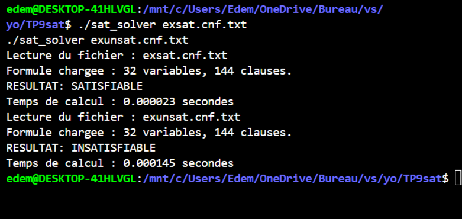

# Solveur SAT (Satisfaisabilité Booléenne en Langage C)

Implémentation d'un solveur pour le problème **SAT** (problème NP-complet fondamental de décision booléenne) en **C**, acceptant des instances modélisées en forme normale conjonctive (**CNF**) au standard industriel **DIMACS**.

---

## Fonctionnalités

- **Moteur de décision :** Algorithme de type **DPLL** (*Davis-Putnam-Logemann-Loveland*) avec gestion dynamique du retour sur trace (*backtracking*).
- **Structures de données optimisées :** Suivi des clauses par littéraux surveillés (**Two Watched Literals**) pour accélérer la propagation unitaire sans réévaluer l'intégralité des clauses à chaque affectation.
- **Parser DIMACS CNF :** Chargement et instanciation dynamique des formules depuis des fichiers d'instances standardisés.
- **Instrumentation :** Mesure du temps CPU d'exécution à l'aide de l'horloge système (`clock()`).

---

## Aperçu de l'exécution



---

## Compilation et exécution

```bash
# Compilation avec optimisations de niveau 2 (-O2)
gcc -Wall -O2 main.c parser.c TP9_test1.c TP9_test2.c TP9_test3.c TP9_test4.c TP9_test5.c -o sat_solver

# Résolution d'une instance satisfiable
./sat_solver exsat.cnf.txt

# Résolution d'une instance insatisfiable
./sat_solver exunsat.cnf.txt
